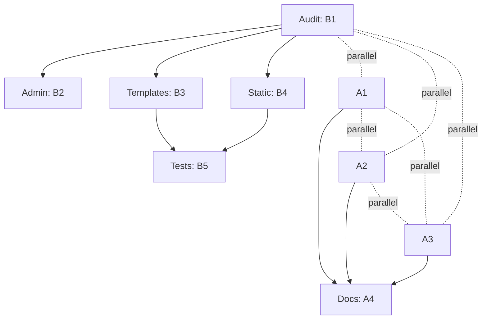

# Master Plan: SEO Overhaul + Theme System Overhaul (Color Only)

**Project:** Durrat Tarim Django + Tailwind v4  
**Date:** 2026-11-20  
**Base Branch:** main (commit 20a2f66)  
**Integration Branch:** `dev/integration` (to be created)

---

## 🎯 Objectives

| Task | Goal |
|------|------|
| **Task A: SEO Overhaul** | Production-ready SEO: meta tags, structured data (Product/Category/Breadcrumb), sitemap.xml, robots.txt, documentation |
| **Task B: Theme System Overhaul (Color Only)** | Centralized design tokens in Tailwind v4 `@theme`, admin-manageable via StoreSettings, zero inline styles in templates, full test coverage |

---

## 🌿 Branch Strategy

All work happens on feature branches off `main`. Final integration via `dev/integration`.

| Agent | Branch | Base | Merge Target |
|-------|--------|------|--------------|
| A1 | `dev/seo-meta-tags` | main | dev/integration |
| A2 | `dev/seo-structured-data` | main | dev/integration |
| A3 | `dev/seo-sitemap` | main | dev/integration |
| A4 | `dev/seo-docs` | main | dev/integration |
| B1 | `dev/theme-audit` | main | dev/integration |
| B2 | `dev/theme-admin` | main | dev/integration |
| B3 | `dev/theme-templates` | main | dev/integration |
| B4 | `dev/theme-static` | main | dev/integration |
| B5 | `dev/theme-tests` | main | dev/integration |

---

## ⏱️ Sequencing Rules (CRITICAL)



**Rules:**
1. **B1 MUST complete before B2, B3, B4 start** — B1 produces `theme-plan.md` with final token inventory
2. **B2 can run in parallel with B1** — but only for admin field scaffolding; actual field definitions wait on B1's plan
3. **B3 and B4 run in parallel after B1 completes** — both consume B1's token inventory
4. **B5 runs after B3 AND B4 complete** — tests validate integrated result
5. **A1, A2, A3 run in parallel (Wave 1)** — independent SEO tasks
6. **A4 runs after A1, A2, A3 complete** — docs consolidate all SEO work
7. **Cross-task coordination:** `theme-color` meta tag in head.html
   - If A1 lands first: use `content="#TODO(theme)"` with comment `<!-- TODO(theme): replace with dynamic token after B3/B4 -->`
   - If B3 lands first: use `content="{{ site_settings.light_color_background|default:'#f6f1ee' }}"` or CSS variable approach

---

## 📋 Agent Specifications

### Task A: SEO Overhaul

#### Agent A1: Meta Tags (`dev/seo-meta-tags`)
**Scope:** `templates/partials/head.html`
**Deliverables:**
- [ ] Dynamic `<title>` with proper fallback hierarchy (page_title → product.name → category.name → site name)
- [ ] Dynamic `meta description` with truncation (160 chars), fallback chain
- [ ] Open Graph: ensure all required tags (type, url, title, description, image, site_name, locale)
- [ ] Twitter Card: summary_large_image with dynamic image
- [ ] Canonical URL: strip query params, handle pagination (`?page=N`)
- [ ] `theme-color` meta: **use `TODO(theme)` placeholder** (see cross-task rule)
- [ ] `robots` meta: `index,follow` default; `noindex` for search results, auth pages
- [ ] `hreflang` if multi-language planned (placeholder for future)
- [ ] Viewport, charset, prefetch/preconnect optimizations

**Acceptance Criteria:**
- All meta tags render correctly on home, category, product, search, contact pages
- No duplicate tags
- `theme-color` has TODO comment for Theme team

---

#### Agent A2: Structured Data (`dev/seo-structured-data`)
**Scope:** `templates/partials/head.html` + product/category templates
**Deliverables:**
- [ ] **Product JSON-LD** on product detail pages:
  - `@type: Product`
  - name, description, image[], brand, sku, offers (price, currency, availability, seller), aggregateRating (if reviews exist)
- [ ] **Category/CollectionPage JSON-LD** on category pages:
  - `@type: CollectionPage` or `ItemList`
  - mainEntity.itemListElement[] with Product references
- [ ] **BreadcrumbList JSON-LD** on all pages (home > category > product):
  - `@type: BreadcrumbList`
  - itemListElement[] with position, name, item (URL)
- [ ] **Organization JSON-LD** (already exists — verify completeness)
- [ ] **WebSite JSON-LD** with SearchAction for sitelinks searchbox
- [ ] Template tags/helpers for reusable structured data generation

**Acceptance Criteria:**
- Google Rich Results Test passes for Product, Category, Breadcrumb
- No invalid/duplicate JSON-LD
- Structured data matches visible content

---

#### Agent A3: Sitemap + Robots (`dev/seo-sitemap`)
**Scope:** `durrat_tarim/urls.py`, `catalog/sitemaps.py`, new `robots.txt` template/view
**Deliverables:**
- [ ] Wire sitemaps in `urls.py`:
  ```python
  from django.contrib.sitemaps.views import sitemap
  from catalog.sitemaps import StaticViewSitemap, CategorySitemap, ProductSitemap
  
  sitemaps = {
      'static': StaticViewSitemap,
      'categories': CategorySitemap,
      'products': ProductSitemap,
  }
  urlpatterns += [path('sitemap.xml', sitemap, {'sitemaps': sitemaps}, name='sitemap')]
  ```
- [ ] Add `lastmod` to StaticViewSitemap items (use latest Product/Category updated_at)
- [ ] Create `robots.txt` (template or view):
  ```
  User-agent: *
  Allow: /
  
  Disallow: /admin/
  Disallow: /auth/
  Disallow: /dashboard/
  Disallow: /search/?q=*
  
  Sitemap: https://durrat-tarim.com/sitemap.xml
  ```
- [ ] Ensure `sitemap.xml` returns valid XML with proper namespaces
- [ ] Test: `curl /sitemap.xml`, `curl /robots.txt`

**Acceptance Criteria:**
- `/sitemap.xml` returns valid sitemap index with 3 sub-sitemaps
- `/robots.txt` returns correct directives
- Google Search Console can fetch both without errors

---

#### Agent A4: SEO Documentation (`dev/seo-docs`)
**Scope:** `docs/seo-checklist.md`, `docs/seo-implementation.md`
**Deliverables:**
- [ ] `docs/seo-checklist.md` — Pre-deploy checklist:
  - Meta tags verification
  - Structured data validation (Rich Results Test)
  - Sitemap submission steps
  - Robots.txt verification
  - Core Web Vitals targets
- [ ] `docs/seo-implementation.md` — Technical docs:
  - Template variable reference (page_title, meta_description, og_image, etc.)
  - How to add JSON-LD to new page types
  - Sitemap extension guide
  - Theme-color integration note (cross-ref Task B)
- [ ] Update `docs/recon.md` with final state

**Acceptance Criteria:**
- Docs are actionable for future maintainers
- Checklist covers all launch requirements

---

### Task B: Theme System Overhaul (Color Only)

#### Agent B1: Audit + Token Inventory + Plan (`dev/theme-audit`) **MUST RUN FIRST**
**Scope:** Full codebase audit → `docs/theme-plan.md`
**Deliverables:**
- [ ] **Token Inventory:** Map every color usage across:
  - `catalog/models.py` (10 StoreSettings fields)
  - `catalog/admin.py` (fieldsets)
  - `templates/partials/head.html` (inline CSS custom properties)
  - `static/css/input.css` (@theme tokens + rose palette)
  - `static/js/theme.js` (any hardcoded colors)
  - All template files (search for `bg-`, `text-`, `border-`, `from-`, `to-`, `via-` color classes)
- [ ] **Gap Analysis:** 
  - Tailwind @theme vs CSS custom properties mismatch (6 vs 10)
  - Hardcoded colors in templates (Tailwind classes using arbitrary values)
  - Missing tokens: surface, secondary, border, focus, etc.
- [ ] **Design Token Proposal:** Final `@theme` token set (minimum 10 color tokens matching StoreSettings + semantic aliases)
- [ ] **Migration Strategy:** 
  - Phase 1: Expand @theme to cover all 10 StoreSettings fields + semantic aliases
  - Phase 2: Replace inline CSS custom properties with Tailwind tokens
  - Phase 3: Update admin to match new token structure
  - Phase 4: Remove inline `<style>` block from head.html
- [ ] **Output:** `docs/theme-plan.md` with:
  - Complete token inventory table
  - Final @theme token list (names + default values)
  - Migration phases with file-level tasks
  - Breaking changes (if any)
  - Rollback plan

**Acceptance Criteria:**
- `docs/theme-plan.md` is complete and approved before B2/B3/B4 start
- Token inventory covers 100% of color usage in codebase
- Plan is actionable for B2, B3, B4

---

#### Agent B2: StoreSettingsAdmin Updates (`dev/theme-admin`)
**Scope:** `catalog/models.py`, `catalog/admin.py`
**Depends On:** B1's `theme-plan.md` (final token list)
**Deliverables:**
- [ ] Update `StoreSettings` model fields per B1 plan:
  - Keep 10 color fields (or adjust per plan)
  - Add validators for new fields if needed
  - Ensure `_validate_hex_color` covers all fields
- [ ] Update `StoreSettingsAdmin` fieldsets per B1 plan:
  - Logical grouping (Light/Dark + semantic categories)
  - Help text linking to token names
  - Color preview widgets (optional: django-color-widget)
- [ ] Maintain singleton behavior (`pk=1` enforcement)
- [ ] Add migration if fields change
- [ ] Test: Admin loads, saves, preview works

**Acceptance Criteria:**
- Admin reflects final token structure from B1
- All fields validate hex colors
- No data loss on migration

---

#### Agent B3: Template Refactor (`dev/theme-templates`)
**Scope:** All templates (`templates/**/*.html`), `templates/partials/head.html`
**Depends On:** B1's `theme-plan.md` (final token names)
**Deliverables:**
- [ ] **Remove inline `<style>` block** from `head.html` (lines 92-115) — colors now via Tailwind
- [ ] **Replace all hardcoded Tailwind color classes** with semantic tokens:
  - `bg-background` → `bg-[var(--color-background)]` or `bg-background` (if @theme defines it)
  - `text-secondary` → `text-secondary` (if @theme defines it)
  - `border-accent/15` → `border-accent/15` (if @theme defines accent)
  - etc.
- [ ] **Update `theme-color` meta tag** in head.html:
  ```html
  <meta name="theme-color" content="{{ site_settings.light_color_background|default:'#f6f1ee' }}" media="(prefers-color-scheme: light)" />
  <meta name="theme-color" content="{{ site_settings.dark_color_background|default:'#08121b' }}" media="(prefers-color-scheme: dark)" />
  ```
  Or use CSS variable approach if Tailwind tokens map to CSS variables
- [ ] **Audit every template** for:
  - Arbitrary color values: `bg-[#...]`, `text-[#...]`, `border-[#...]`
  - Hardcoded gradients: `from-[#...]`, `to-[#...]`
  - Replace with semantic token classes
- [ ] Ensure RTL layout unaffected
- [ ] Test: All pages render correctly in light + dark mode

**Acceptance Criteria:**
- Zero inline styles for colors in head.html
- Zero arbitrary color values in templates
- All colors controlled via Tailwind @theme tokens
- Dark mode works via `html.dark` class toggle

---

#### Agent B4: Static Files — Tailwind @theme Expansion (`dev/theme-static`)
**Scope:** `static/css/input.css`, `package.json` (build script)
**Depends On:** B1's `theme-plan.md` (final token list)
**Deliverables:**
- [ ] Expand `@theme` in `input.css` to include all tokens from B1 plan:
  - 10 color tokens matching StoreSettings (light + dark variants via `dark:` or CSS variables)
  - Semantic aliases: `--color-surface`, `--color-secondary`, `--color-border`, `--color-focus`, `--color-text`
  - Rose palette (keep existing)
  - Font tokens (keep existing)
- [ ] **Dark mode strategy:** Use CSS custom properties with `html.dark` selector (current approach) OR Tailwind v4 `dark:` variant in @theme — document decision
- [ ] Ensure `@source` paths cover all templates + JS
- [ ] Build: `npm run build` → verify `output.css` contains all tokens
- [ ] Test: Dev server renders with new tokens

**Acceptance Criteria:**
- `input.css` @theme has complete token set per B1 plan
- `npm run build` succeeds without errors
- `output.css` includes all token definitions
- Dark mode tokens work via `html.dark`

---

#### Agent B5: Theme Tests (`dev/theme-tests`)
**Scope:** New test files + existing test suite
**Depends On:** B3 (templates), B4 (static) complete
**Deliverables:**
- [ ] **Model Tests** (`catalog/tests/test_store_settings.py`):
  - Singleton enforcement (only one instance)
  - Hex color validation (valid/invalid)
  - Default values
  - `load()` method returns instance
- [ ] **Admin Tests** (`catalog/tests/test_admin.py`):
  - Fieldsets render correctly
  - `has_add_permission` blocks second instance
  - Color fields save/load correctly
- [ ] **Template Tests** (`catalog/tests/test_templates.py` or `templates/tests/`):
  - `head.html` renders without inline `<style>` block
  - `theme-color` meta tag uses dynamic values
  - All color classes in templates use semantic tokens (grep test)
- [ ] **Static/CSS Tests**:
  - `npm run build` produces valid CSS
  - `output.css` contains all expected @theme tokens
  - Dark mode selectors present
- [ ] **Integration Test** (Selenium/Playwright or Django test client):
  - Home page renders in light mode
  - Theme toggle switches to dark mode (localStorage persists)
  - Colors update correctly in both modes
  - No console errors

**Acceptance Criteria:**
- All tests pass: `pytest` (or `python manage.py test`)
- `npm run build` passes in CI
- Coverage ≥ 80% for theme-related code

---

## ✅ Definition of Done (Per Agent)

| Agent | Done When |
|-------|-----------|
| A1 | PR merged, meta tags verified on all page types |
| A2 | PR merged, Rich Results Test passes for Product/Category/Breadcrumb |
| A3 | PR merged, `/sitemap.xml` and `/robots.txt` return valid responses |
| A4 | PR merged, docs published in `docs/` |
| B1 | PR merged, `docs/theme-plan.md` approved by lead |
| B2 | PR merged, admin reflects final token structure |
| B3 | PR merged, zero inline styles, zero arbitrary colors in templates |
| B4 | PR merged, `npm run build` succeeds, all tokens in output.css |
| B5 | PR merged, all tests pass in CI |

---

## 🔀 Integration Plan

1. **Create `dev/integration` branch** from `main`
2. **Merge all 9 feature branches** into `dev/integration` (resolve conflicts)
3. **Run full test suite:** `pytest` + `npm run build` + manual smoke test
4. **Verify cross-task coordination:** `theme-color` meta tag uses dynamic token
5. **Create final PR:** `dev/integration` → `main`
6. **Deploy to staging** (Vercel preview) for final validation
7. **Merge to main** after approval

---

## 📅 Estimated Timeline

| Wave | Agents | Est. Duration |
|------|--------|---------------|
| 1 | B1, A1, A2, A3 (parallel) | 2-3 hours |
| 2 | B2, B3, B4 (parallel, after B1) | 2-3 hours |
| 3 | B5, A4 (parallel, after B3+B4 / A1+A2+A3) | 1-2 hours |
| Integration | Merge + test + deploy | 1 hour |
| **Total** | | **6-9 hours** |

---

## 🚨 Risk Mitigation

| Risk | Mitigation |
|------|------------|
| B1 delays block B2/B3/B4 | B1 is highest priority; lead reviews plan within 30 min of PR |
| Token mismatch between B3/B4 | B1's plan is source of truth; both agents reference same `theme-plan.md` |
| Theme-color meta tag conflict | Explicit TODO(theme) placeholder rule documented above |
| Tailwind v4 build failures | B4 validates `npm run build` locally before PR |
| Arabic RTL breakage | B3 tests RTL layout; B5 includes visual regression check |

---

## 📝 Notes for Agents

- **All agents:** Work on feature branch, open PR to `dev/integration` (not main directly)
- **All agents:** Follow existing code style (4-space indent, single quotes, trailing commas)
- **All agents:** Write commit messages: `feat(scope): description` / `fix(scope): description`
- **All agents:** Update `docs/recon.md` if you discover new findings
- **B1:** Your `theme-plan.md` is the contract — be exhaustive
- **B3/B4:** Coordinate on dark mode strategy (CSS variables vs Tailwind dark:)
- **A1:** Use `TODO(theme)` placeholder for theme-color — do NOT hardcode
- **A4:** Cross-reference B1's theme-plan.md for theme-color integration note

---

## 🎬 Next Actions (Orchestrator)

- [ ] Create `dev/integration` branch and push to origin
- [ ] Spawn Agent B1 (priority: highest)
- [ ] Spawn Agents A1, A2, A3 (parallel, can start immediately)
- [ ] Monitor B1 PR → approve theme-plan.md → spawn B2, B3, B4
- [ ] Monitor A1/A2/A3 PRs → approve → spawn A4
- [ ] Monitor B3/B4 PRs → approve → spawn B5
- [ ] Integration merge + final report